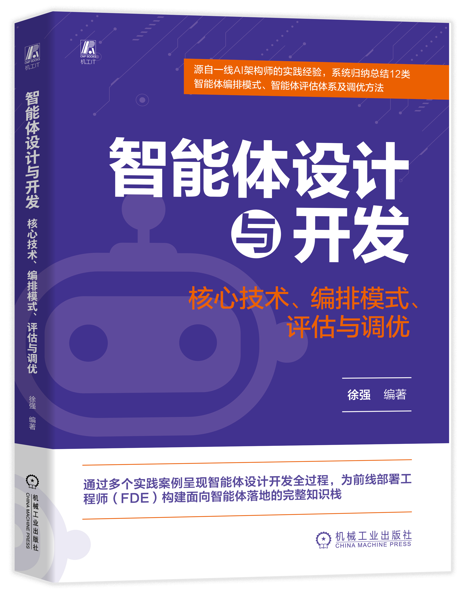

# 《智能体设计与开发：核心技术、编排模式、评估与调优》

<p align="center">
  
</p>

<p align="center">
  <strong>徐强 编著</strong>　|　机械工业出版社　|　<strong>2026 年 11 月上市</strong><br>
  源自一线 AI 架构师的实践经验，系统归纳总结 12 类智能体编排模式、智能体评估体系及调优方法<br>

  https://item.jd.com/15548630.html 
</p>

本仓库是该书的**官方配套代码**：共 **125 个 Python 文件**，覆盖第 2～6 章（第 1 章「认识智能体」为认知篇，无配套代码），与书中示例一一对应。

<p align="center">
  <br>
  扫码关注微信公众号，获取本书动态、配套资源与读者交流渠道
</p>

---

## 目录

- [书籍简介](#书籍简介)
- [全书目录](#全书目录)
- [快速开始](#快速开始)
- [环境要求（务必先读）](#环境要求务必先读)
- [各章内容与运行方式](#各章内容与运行方式)
---

## 书籍简介

本书聚焦智能体（Agent）这一人机协作的核心载体，系统梳理其从「AI 工具」到「数字员工」的认知升维路径，构筑了从技术原理到工程落地的完整智能体设计开发知识框架。

书中详细剖析了智能体的五大核心组件——「大脑」（LLM）、「记忆」（向量数据库）、「手脚」（工具调用）、「流程」（工作流）、「沟通」（A2A）——的定位、协作逻辑与关键技术，帮助开发者精准构建智能体技术栈；并系统归纳总结了单智能体模式、推理与行动模式（ReAct）、确定性多智能体模式、人机协同模式等 **12 种智能体编排模式**的定义、适用场景与工作流程，帮助读者清晰把握不同智能体模式的任务拆解逻辑与智能体的演进方向。

本书兼具理论深度与实践指导价值，通过多个智能体设计开发实战案例，呈现从需求分析、架构搭建、质量评估，到 SOP 标准化、知识库优化、模型微调等调优方法的**智能体设计开发完整闭环**。全书以「道－术－器－用」为逻辑主线，层层递进：

| 章   节   | 主题 | 内容要点 |
| --- | --- | --- |
| 第 1 章 | 认识智能体 | 以「数字员工」的隐喻破除认知迷思，厘清智能体与传统软件、聊天机器人的本质差异，勾勒效率提升、价值创造、体验革新三大应用图景 |
| 第 2 章 | 智能体技术栈 | 五大核心组件与提示工程、思维链、检索增强生成等关键技术；开发环境准备、LangChain 与公共云开发框架、Skills 技能体系与技术选型 |
| 第 3 章 | 打造你的第一个智能体 | 以客服智能体为例，完整演示 5W1H 需求分析、用户故事设计、系统搭建与测试评估的全流程 |
| 第 4 章 | 智能体编排模式 | 12 种编排模式的定义与 LangGraph 等框架代码；4.8 节逐级构建代码生成工具、数据处理系统、旅行智能体与智能供应链管理系统四个递进案例 |
| 第 5 章 | 智能体评估 | 功能性能、用户体验、业务价值、技术质量四维评估体系，定量、定性与综合评分方法，以及人机协同评估的实施流程 |
| 第 6 章 | 智能体调优 | 从标准作业程序（SOP）、知识库调优、模型参数调优，到模型训练调优与系统级调优，揭示智能体从可用到可靠、从专业迈向卓越的进阶路径 |

本书适合系统架构师、AI 开发工程师、AI 产品经理、企业管理者参考阅读，
也适合高校人工智能相关专业作为教材使用。

> ❓ **智能体都能自己写代码了，为什么还要学写代码？**
>
> 恰恰相反——智能体越能写代码，人的代码功底就越值钱。大模型生成的代码，
> 绝大多数都是在**用户特定要求**下产出的：提示词的质量，直接决定了代码的质量。
> 没有真正动手写过代码的人，在与智能体协作时往往说不清需求边界、看不懂生成结果、
> 也判断不出哪里埋着坑——原理和细节不清楚，提示词就只能停留在「帮我写一个某某功能」
> 的层面，产出的代码自然不尽如人意，甚至看起来能跑、一上线就崩。
>
> 真正写过代码的人则相反：他知道该给模型哪些约束、能一眼识破幻觉 API 与错误假设、
> 能在结果偏离时精准纠偏，还能把模糊的业务诉求翻译成模型可执行的技术规格。
> 换句话说，**智能体放大的是你已有的能力，而不是替代这种能力**。
> 这正是本书坚持把技术原理、编排模式与评估调优讲透，并配套完整可运行示例的原因：
> 你得先建立自己的判断力，才能指挥智能体替你写出好代码。

> 💡 **一个更高效的读书方法**：不必纯文字阅读——直接下载本仓库配套代码，
> 先运行示例代码，真正看到智能体在进行对话、调用工具与完成任务，
> 再回头看书，理论与实践相互印证，理解会更深刻。
> 这种「代码先行、书本印证」的方式，正是许多高效工程师的实战习惯。

**出版信息**：《智能体设计与开发：核心技术、编排模式、评估与调优》，徐强 编著，
机械工业出版社，**2026 年 11 月上市**。本书免费提供案例涉及的数据集、代码等资源，
获取方式见封底与上方公众号二维码。

---

## 全书目录

> 以下目录照录该书印刷目录原文。

- 自序
- 前言
- **第 1 章　认识智能体**
  - 1.1　智能体究竟是什么？
    - 1.1.1　超越聊天机器人：智能体的核心四要素
    - 1.1.2　一个生动的比喻：作为「数字员工」的智能体
    - 1.1.3　传统软件、聊天机器人与智能体的本质区别是什么
  - 1.2　智能体能用在什么地方？
    - 1.2.1　效率提升：不知疲倦的「数字劳动力」
    - 1.2.2　价值创造：深度赋能的「行业专家」
    - 1.2.3　体验革新：虚实交融的「情境伙伴」
  - 1.3　终局思维：在「技能通胀」时代重铸人类护城河
- **第 2 章　智能体技术栈**
  - 2.1　智能体的核心组件
    - 2.1.1　「大脑」：大语言模型（LLM）
    - 2.1.2　「记忆」：向量数据库与记忆管理
    - 2.1.3　「手脚」：工具调用（Function Calling）与行动能力
    - 2.1.4　「流程」：协调整个业务场景的工作流
    - 2.1.5　「沟通」：A2A 智能体间通信协议
  - 2.2　智能体开发核心技术
    - 2.2.1　提示工程与上下文工程
    - 2.2.2　思维链与推理技术
    - 2.2.3　检索增强生成技术
  - 2.3　智能体开发环境准备
    - 2.3.1　下载本书配套代码
    - 2.3.2　Python 环境搭建
    - 2.3.3　VS Code 开发环境准备
    - 2.3.4　公共云模型环境准备（以阿里云百炼为例）
    - 2.3.5　LangChain 环境准备
  - 2.4　智能体开发框架
    - 2.4.1　LangChain 智能体开发框架
    - 2.4.2　公共云智能体开发框架
  - 2.5　Skills：从工具调用到可编排的技能体系
    - 2.5.1　演进脉络：从可编辑规则引擎到技能包
    - 2.5.2　概念与定位：技能包与「手脚」的再组织
    - 2.5.3　核心机制：渐进式披露与可附带资源
    - 2.5.4　Skills 与 RAG 的对照
    - 2.5.5　Skills 内部实现说明
    - 2.5.6　使用 Langchain 调用 docx 技能包创建文档
  - 2.6　如何选择智能体技术栈
    - 2.6.1　技术框架对比
    - 2.6.2　技术选型核心决策维度
    - 2.6.3　实践建议
  - 2.7　本章小结
- **第 3 章　打造你的第一个智能体———以客服智能体为例**
  - 3.1　产品需求分析
    - 3.1.1　5W1H 分析法
    - 3.1.2　用户故事设计法
    - 3.1.3　小结
  - 3.2　客服智能体需求分析与场景定义
    - 3.2.1　To C 场景需求分析：直面终端用户
    - 3.2.2　To B 场景需求分析：赋能企业内部与合作伙伴
    - 3.2.3　跨场景需求整合与优先级判定
  - 3.3　智能体系统搭建：兼顾 To B 和 To C 场景
    - 3.3.1　技术选型与架构设计
    - 3.3.2　客服智能体的实现
    - 3.3.3　客服智能体的运行
    - 3.3.4　客服智能体核心实现要点与设计思想
  - 3.4　系统测试与验证
    - 3.4.1　功能测试用例设计
    - 3.4.2　性能基准测试
  - 3.5　本章小结
- **第 4 章　智能体编排模式：适应各类复杂任务**
  - 4.1　单智能体模式
    - 4.1.1　运行方式
    - 4.1.2　核心机制：工具调用与提示词
    - 4.1.3　单智能体的边界与演进
  - 4.2　推理与行动（ReAct）模式
    - 4.2.1　基础 ReAct 模式：思考－行动－观察
    - 4.2.2　进阶任务规划：引入任务规划中间件
    - 4.2.3　任务执行流程分析
  - 4.3　确定性多智能体模式
    - 4.3.1　顺序模式
    - 4.3.2　并行模式
    - 4.3.3　循环模式
  - 4.4　质量保证与迭代模式
    - 4.4.1　审核与评判模式
    - 4.4.2　迭代优化模式：逐步改进输出
  - 4.5　动态编排多智能体模式
    - 4.5.1　协调器模式
    - 4.5.2　分层任务分解模式：多级问题分解
    - 4.5.3　集群模式
  - 4.6　特殊集成与自定义模式
    - 4.6.1　人机协同模式
    - 4.6.2　自定义逻辑模式
  - 4.7　智能体编排模式选型与比较
    - 4.7.1　基于任务特性的模式选型
    - 4.7.2　复杂场景下的模式组合选型
  - 4.8　智能体编排模式实践
    - 4.8.1　低代码实现智能体编排
    - 4.8.2　高代码实现智能体编排
    - 4.8.3　Agentic Coding 方式实现智能体编排———基于通义千问
    - 4.8.4　Agentic Coding 方式实现智能体编排———基于 OpenClaw＋Qoder
  - 4.9　本章小结
- **第 5 章　智能体评估**
  - 5.1　四维评估体系
    - 5.1.1　功能性能维度：精准完成核心任务
    - 5.1.2　用户体验维度：自然、愉悦的人机交互
    - 5.1.3　业务价值维度：驱动实际业务成果
    - 5.1.4　技术质量维度：稳健、安全、可持续的工程系统
  - 5.2　评估指标体系及具体评估方法
    - 5.2.1　评估指标体系
    - 5.2.2　定量评估方法
    - 5.2.3　定性评估方法
    - 5.2.4　综合评分方法
  - 5.3　智能体评估的实施流程
    - 5.3.1　第一阶段：计划制定
    - 5.3.2　第二阶段：数据收集与处理
    - 5.3.3　第三阶段：结果分析与报告
  - 5.4　人机协同评估
    - 5.4.1　人机协同评估概述
    - 5.4.2　基于 5W1H 框架制定评估计划
    - 5.4.3　智能体评估系统的设计开发
    - 5.4.4　对电商智能体实施评估
  - 5.5　本章小结
- **第 6 章　智能体调优**
  - 6.1　确立行为标准：标准作业程序（SOP）
    - 6.1.1　SOP 的概念、作用与应用场景
    - 6.1.2　SOP 示例：客服智能体的问题分析
  - 6.2　构建外部大脑：知识库调优
    - 6.2.1　知识库调优概述
    - 6.2.2　文本知识库调优：从理论到实践的桥梁
    - 6.2.3　优化客服智能体：从理论到代码的落地
  - 6.3　校准思维方式：模型参数调优
    - 6.3.1　模型参数调优
    - 6.3.2　常见模型参数及调优
    - 6.3.3　高级模型参数介绍及调优
  - 6.4　重塑核心能力：模型训练调优
    - 6.4.1　Embedding 模型调优：提升语义检索精度
    - 6.4.2　Embedding 模型调优实践：提升数据召回率
    - 6.4.3　大语言模型后训练调优策略
    - 6.4.4　大语言模型模型后训练调优实践
    - 6.4.5　使用阿里云百炼进行在线调优训练
  - 6.5　打造强健体魄：系统级调优
    - 6.5.1　架构优化建议
    - 6.5.2　系统性能调优
    - 6.5.3　成本效益优化
  - 6.6　建立进化机制：规范、监控与闭环
    - 6.6.1　资源使用规范
    - 6.6.2　功能复用规范
    - 6.6.3　开发接口规范
    - 6.6.4　专有业务沉淀规范
    - 6.6.5　对外通信规划
    - 6.6.6　监控、评估与持续改进闭环
  - 6.7　本章小结

---

## 快速开始

```powershell
# 1. 确认使用 Python 3.11（见下方「环境要求」）
python --version          # 应输出 Python 3.11.x

# 2. 安装根目录依赖
python -m pip install -r requirements.txt

# 3. 配置 API Key（推荐用环境变量，见「环境要求 §3」）
$env:TONGYI_API_KEY = "sk-你的百炼API密钥"
或修改common\config.py 

API_KEYS = {
    "tongyi": os.getenv("TONGYI_API_KEY", "sk-你的百炼API密钥")
}

# 4. Windows 控制台必须设置 UTF-8，否则含 emoji 的脚本会崩溃
$env:PYTHONIOENCODING = "utf-8"

# 5. 运行任意示例
python chapter-2\hello_tongyi_qwen.py
```
---

## 环境要求（务必先读）

### 1. Python 版本：3.11

本书全部代码在 **Python 3.11.9** 上验证通过。

> **如果你机器上装了多个 Python，请先确认 `python` 命令指向的是哪一个。**
> 用 `python -c "import sys; print(sys.executable)"` 查看实际路径。
> 若指向的是另一个版本（例如 3.12），依赖会装到错误的解释器里，表现为
> `ModuleNotFoundError`——但 `pip list` 看起来一切正常。这是本仓库最容易踩的坑。

IDE 用户请同时检查编辑器选中的解释器与终端 `python` 是否一致。

### 2. Windows 控制台编码

Windows 中文控制台默认使用 GBK 编码。书中多个脚本会输出 emoji 与中文，
不设置编码会抛出：

```
UnicodeEncodeError: 'gbk' codec can't encode character '\U0001f680'
```

运行前设置：

```powershell
$env:PYTHONIOENCODING = "utf-8"
$env:PYTHONUTF8 = "1"
```

若脚本涉及 matplotlib 绘图且无显示环境，再加 `$env:MPLBACKEND = "Agg"`。

### 3. API 密钥配置

密钥统一由 `common/config.py` 管理，当前默认为千问：

| 环境变量 | 供应商 | 
| --- | --- | 
| `TONGYI_API_KEY` | 阿里云百炼（通义千问） | 


**生产环境请务必改用环境变量覆盖它**，不要提交自己的真实密钥。

> ℹ️ **排查口诀**：调用返回 `401` 是密钥问题，返回 `404 Model not exist` 是模型名问题，
> 两者不要混为一谈。本书配套代码使用的模型名均已对齐当前在售模型目录。

> ℹ️ **每个导入 `langchain_community` 的脚本都会打印一条 `DeprecationWarning`**：
> `'langchain-community' is being sunset and is no longer actively maintained.`
> 这是上游的**弃用预告，不是错误**，不影响运行，也不会改变任何返回值。
> 全书 **33 个 `.py`** 导入了 `langchain_community`（其中 **31 个**用的是
> `langchain_community.chat_models.tongyi.ChatTongyi`），在 langchain 1.4.4 下
> 均可正常导入与调用。

### 4. 依赖栈已整体上调到 langchain 1.4.x

书稿写作时把 `langchain` 钉在 **1.1.0**。该旧栈在今天全新安装时，`langgraph-prebuilt` 与 `langgraph` 的版本组合会触发一个导入错误（`ImportError: cannot import name 'ExecutionInfo' from 'langgraph.runtime'`），波及全书 22 个使用 `from langchain.agents import create_agent` 的文件。

**本仓库已将依赖栈整体上调到 langchain 1.4.x，该问题从根上消失**：
`langchain` 上调到 **1.4.4** 后，`langgraph` 解析到 **1.2.14**，
其 `runtime.py` 提供了 `langgraph-prebuilt 1.1.0` 所需的全部符号，无需任何手工补钉。

根 `requirements.txt` 已按新栈整体重写（含 `deepagents`、`torch`、`transformers` 等
此前只靠传递依赖引入的包），直接安装即可：

```powershell
python -m pip install -r requirements.txt

# 自检：能打印出 create_agent 就说明装对了
python -c "from langchain.agents import create_agent; print('OK')"
```

Linux / macOS 同理：

```bash
python -m pip install -r requirements.txt
python -c "from langchain.agents import create_agent; print('OK')"
```


### 各章 requirements.txt 说明

仓库内共有 9 个 `requirements.txt`。除根目录外，其余为局部补充，
且都已与根配方对齐到 langchain 1.4.x 新栈：

| 文件 | 说明 |
| --- | --- |
| `requirements.txt` | 主依赖，覆盖全书第 2～6 章。**45 条声明**，在全新空 venv 中真实安装得 **190 个包、退出码 0、`pip check` 无破损依赖**，并跑完 **51 项导入测试全部通过** |
| `chapter-3/requirements.txt` | 本章 4 个文件都 import `langgraph`，配方已补齐并对齐新栈 |
| `chapter-5/requirements.txt` | 5.4 节评估系统用到 langchain / langgraph / `jieba` / `rouge` / `scikit-learn` / `pandas` 等，已按代码实际 import 补齐至 16 条 |
| `chapter-4/requirements.txt` | 按代码实际 import 声明 `pypdf`（而非已停维的 PyPDF2），并含 `pdf2image`、`scipy`。`bs4==0.0.2` 予以保留（官方**转发占位包**，会自动拉入 `beautifulsoup4` 真包） |
| `chapter-2/2.5/requirements.txt` | 新栈自足配方（`deepagents==0.7.23` ＋ langchain 1.4.x），**不再需要独立 venv**，详见上一节 |
| `chapter-4/4.8.4/qoder/requirements.txt` | 已对齐 langchain 1.4.x 栈（`langchain==1.4.4`、`langchain-core==1.6.9`、`langchain-community==0.4.2`、`langgraph==1.2.14`、`langgraph-prebuilt==1.1.0`、`dashscope==1.27.7`），该目录代码用到的 `create_agent` / `TodoListMiddleware` 只存在于 langchain 1.x |
| `chapter-4/4.8.5/smart-supply-chain-system/requirements.txt` | 含 `scipy`（`src/dynamic_cost_optimization.py` 需要）。其中 `asyncpg` / `redis` / `celery` / `apscheduler` 是生产部署用的外部服务后端，**核心协调器与其单元测试不依赖**（已验证通过） |
| `chapter-6/6.5.4/requirements.txt` | 显式声明 `torch` / `transformers`（`checkcuda.py` 与 `inference-Qwen3-0.6B-Base.py` 直接 import），与根配方同版本。`ms-swift` / `swanlab` / `tf-keras` / `torch-c-dlpack-ext` 属 GPU 训练链路；`checkcuda.py` 需 CUDA 版 torch 才能跑通，其余推理脚本 CPU 即可 |
| `chapter-4/4.8.3/neijing_qa_extractor/requirements.txt` | 仅 `pandas` + `numpy`，与代码实际 import 一致 |

---

## 各章内容与运行方式

### 第2章　智能体技术栈（30 个文件）

| 代码目录 | 书中小节 | 内容 |
| --- | --- | --- |
| `2.3.5.2` `2.3.5.3` | 2.3.5 LangChain环境准备（p20；书中无此四级编号） | LangChain 环境校验、通义千问 Hello World |
| `2.4.1` | 2.4.1 LangChain智能体开发框架（p21） | 智能体核心组件：`brain.py`（最小 ReAct）、`brain_with_tool.py`、`brain_chattemplate.py`、`ConversationBufferMemory.py`、`SqlChatMessageHistory.py`、`LCEL_workflow_rag.py`、`langgraph_workflow_rag.py` |
| `2.4.1/A2A` | 2.4.1（p21）＋ 2.1.5 “沟通”：A2A智能体间通信协议（p10） | Agent-to-Agent 通信（需常驻服务，见下） |
| `2.4.1.1` | 2.4.1 LangChain智能体开发框架（p21；书中无此四级编号） | `brain.py` 变体 |
| `2.4.2` | 2.4.2 公共云智能体开发框架（p34） | 仅 `langchain介绍.txt`（LangChain 介绍文本） |
| `2.4.5` | AgentScope → 2.4.2（p34）；PDF 技能 → 2.5 Skills（p47） | AgentScope 技能系统 + PDF 技能 + 库分析技能 |
| `2.5` | 2.5 Skills：从工具调用到可编排的技能体系（p47） | Skills 与 docx 生成（含 deepagents 示例，对应 2.5.6 使用Langchain调用docx技能包创建文档） |

```powershell
python chapter-2\hello_tongyi_qwen.py
python chapter-2\verify_langchain.py
python chapter-2\2.4.1\brain.py
python chapter-2\2.4.5\agent_scope_skills.py          # 3～15 分钟，含多轮真实 ReAct 调用
python chapter-2\2.4.5\test_agent_scope_skills.py     # 单元测试，14 项全通过
```

> ℹ️ **`agent_scope_skills.py` 会给 ReAct 智能体挂 AgentScope 的 `execute_python_code` 工具**，
> 其实现是用同一个解释器执行模型生成的代码（**无沙箱**）。
> 介意的话请在一次性 venv 里跑；它**耗时波动很大**（取决于模型决定调用几轮工具），
> 本仓库回归实测约 **59 s** 即以退出码 0 结束并打印 `[END] 演示完成`。
> 该脚本演示中会用到的 PDF 相关依赖（`pdfplumber` / `reportlab` / `pypdfium2` / `pytesseract`）
> 都已写进根 `requirements.txt`，按配方装好的环境里演示可离线复现。

#### A2A 示例需先启动两个 langgraph dev 服务

`a2a_communication.py` 本身只是**客户端**，它向 `127.0.0.1:2024` 与 `127.0.0.1:2025`
发 JSON-RPC 请求。**两个服务未启动时它会报连接错误——这是架构前置条件，不是依赖问题。**

按 `A2A/readme.txt` 操作。`langgraph dev` 是前台阻塞进程，
因此下面三条命令要**分别开三个终端**执行，且每个终端都从仓库根目录出发：

终端 1 —— 行程规划智能体：

```bash
cd chapter-2/2.4.1/A2A/trip && langgraph dev --port 2024
```

终端 2 —— 航班预订智能体：

```bash
cd chapter-2/2.4.1/A2A/flight && langgraph dev --port 2025
```

终端 3 —— 两个服务都就绪后，发起 A2A 通信：

```bash
python chapter-2/2.4.1/A2A/a2a_communication.py
```

两个目录下均已提供 `langgraph dev` 所需的 `langgraph.json`。
本仓库实测端到端跑通（退出码 0）：行程规划智能体返回完整的巴黎三日游行程，
航班智能体返回航班与价格并完成预订确认。

> ℹ️ **两个 `langgraph.json` 都写了 `"env": ".env"`，但仓库里并没有 `.env`——不影响启动。**
> 该字段指向的文件不存在时会被静默忽略。API 密钥由两个智能体脚本自己从
> `common/config.py` 读取并写入 `os.environ["DASHSCOPE_API_KEY"]`，不依赖 `.env`。
>
> ℹ️ **`A2A/readme.txt` 提到的 `langchain_openai` 实测不需要。**
> 两个智能体脚本用的都是 `langchain_community` 的 `ChatTongyi`，
> 全书 125 个 `.py` 中 **0 个** import `langchain_openai` 或 `ChatOpenAI`，
> 故根配方未声明它。
>
> ⚠️ **`langgraph dev` 还需 `[inmem]` extra**。根配方只钉了基础
> `langgraph-cli==0.4.33`，实测基础包**不含** `langgraph-api` 与 `langgraph-runtime-inmem`，
> 因此 `langgraph dev --help` 能打印，但真正启动服务会失败。跑 A2A 前先补装：
>
> ```powershell
> python -m pip install -U "langgraph-cli[inmem]==0.4.33"
> ```
>
> 该 extra 会额外引入 `langgraph-api` / `langgraph-runtime-inmem` / `uvicorn` /
> `starlette` 等服务端组件。因为只服务于这一个示例、且体积不小，故未并入根配方。

**PDF 技能脚本（`2.4.5/pdf/scripts/`）是命令行工具，必须带参数运行**，
直接执行会打印用法后退出（这是预期行为，不是错误）：

```powershell
python chapter-2\2.4.5\pdf\scripts\check_fillable_fields.py chapter-2\2.4.5\测试.pdf
python chapter-2\2.4.5\pdf\scripts\extract_form_field_info.py 输入.pdf 输出.json
python chapter-2\2.4.5\pdf\scripts\fill_fillable_fields.py 输入.pdf 字段值.json 输出.pdf
```

用法详见 `chapter-2/2.4.5/pdf/forms.md` 与 `SKILL.md`。
`chapter-4/4.8.2/pdf/` 是同一套脚本的副本。

> **注**：`2.4.5/README_OPTIMIZED.md` 中提到的主程序文件名为
> `optimized_agent_scope_skills.py`，实际文件已重命名为 `agent_scope_skills.py`。
> 以实际文件名为准。

### 第3章　打造你的第一个智能体———以客服智能体为例（4 个文件）

```powershell
python chapter-3\customer_service.py                # 交互式 REPL
python chapter-3\customer_service_obj.py            # 面向对象版，交互式 REPL
python chapter-3\customer_service_stream_agent.py   # 流式输出，约 85 秒
python chapter-3\ut_test.py                         # 单元测试，见下方说明
```

`ut_test.py` 支持按类别或单个用例运行：

```powershell
python chapter-3\ut_test.py --category 状态管理
python chapter-3\ut_test.py --category 权限控制
python chapter-3\ut_test.py --test TestCustomerServiceAgent.test_state_reset
```

可选类别：`all`、`基本功能`、`对话管理`、`权限控制`、`错误处理`、
`工作流`、`性能测试`、`边界条件`、`状态管理`。

> ℹ️ **`ut_test.py` 的断言面向真实大模型的自由文本输出**，全量运行时结果会随
> 模型措辞与往返耗时自然波动，属演示性质；按类别分批运行可获得稳定结果，
> 例如 `--category 状态管理`（5 个用例，稳定通过）。

### 第4章　智能体编排模式：适应各类复杂任务（62 个文件）

| 代码目录 | 书中小节 | 内容 |
| --- | --- | --- |
| `4.1` | 4.1 单智能体模式（p78） | Function Call：`functioncall.py`、`functioncall-dynamic_prompt.py` |
| `4.2` | 4.2 推理与行动（ReAct）模式（p82） | `ReAct.py`、`ReAct_todo_middleware.py`（+ debug 版），对应 4.2.1 基础ReAct模式：思考－行动－观察、4.2.2 进阶任务规划：引入任务规划中间件 |
| `4.3` | 4.3 确定性多智能体模式（p86） | `basic_langgraph.py` ＋ 三种基本编排：`4.3.1` 顺序模式、`4.3.2` 并行模式、`4.3.3` 循环模式。另有空目录 `4.3.4`（书中无此号） |
| `4.4` | 4.4 质量保证与迭代模式（p93） | `4.4.1` 审核与评判模式、`4.4.2` 迭代优化模式：逐步改进输出 |
| `4.5` | 4.5 动态编排多智能体模式（p100） | `dynamic_coordinator.py` ＋ `4.5.1` 协调器模式、`4.5.2` 分层任务分解模式：多级问题分解、`4.5.3` 集群模式 |
| `4.6` | 4.6 特殊集成与自定义模式（p115） | `4.6.1` 人机协同模式（Human-in-the-loop）、`4.6.2` 自定义逻辑模式 |
| `4.8.2` | 4.8.2 高代码实现智能体编排（p136） | 综合案例一：代码生成器 + PDF 技能 |
| `4.8.3` | 4.8.3 AgenticCoding方式实现智能体编排———基于通义千问（p146） | 综合案例二：数据处理系统——《黄帝内经》问答抽取与 swift 训练数据生成（书中 p147「以AgenticCoding方式实现一个数据处理系统」、p149「接入数据源并实现智能提取」） |
| `4.8.4` | 4.8.4 AgenticCoding方式实现智能体编排———基于OpenClaw＋Qoder（p151） | 综合案例三：旅行智能体（openclaw 版与 qoder ReAct 版） |
| `4.8.5` | 书中无 4.8.5，内容属 4.8.4（p151–158） | 智能供应链系统（18 个 `.py`） |

```powershell
python chapter-4\4.2\ReAct.py
python chapter-4\4.3\4.3.1\sequential_pattern.py
python chapter-4\4.5\4.5.3\swarm.py
python chapter-4\4.8.5\smart-supply-chain-system\quick_test.py
```

**智能供应链系统（`4.8.5`，书中无此编号，内容属 4.8.4）** 的单元测试：

```powershell
cd chapter-4\4.8.5\smart-supply-chain-system
python -m unittest tests.test_coordinator -v
python -m unittest test_detailed_logging -v
python test_config_loader.py
python src\supply_chain_full_coverage.py
```

主入口 `src/main.py` 是常驻演示服务（约 60 秒），配置文件在 `config/config.yaml`。
其中 `src/cross_enterprise_collaboration.py` 是书中**跨企业协作扩展的讲解片段**，
无独立运行入口，阅读时以其余 17 个 `.py` 为准。

**《黄帝内经》数据处理（`4.8.3`）** 有先后顺序：

```powershell
cd chapter-4\4.8.3\neijing_qa
python convert_to_messages_format.py     # 生成 neijing_qa_messages_<时间戳>.jsonl
python verify_messages_format.py         # 自动匹配上一步的最新产物并校验
```

### 第5章　智能体评估（9 个文件，均在 `5.4/`）

```powershell
python chapter-5\5.4\base_evaluator.py
python chapter-5\5.4\functional_evaluator.py     # 约 15 秒
python chapter-5\5.4\business_evaluator.py
python chapter-5\5.4\technical_evaluator.py
python chapter-5\5.4\ux_evaluator.py
python chapter-5\5.4\report_generator.py
python chapter-5\5.4\main_evaluation_system.py   # 交互式主菜单
```

评估流程说明见 `chapter-5/5.3/评估流程.md`。
`modelscope-qwen-embedding-download.py` 会下载约 1GB 的 embedding 模型。
目录下已有的 `evaluation_report_*.csv/html/json` 是历史运行产物，可直接打开查看报告样式。

### 第6章　智能体调优（19 个文件）

| 代码目录 | 书中小节 | 内容 |
| --- | --- | --- |
| `6.2` | 6.2 构建外部大脑：知识库调优（p198） | SOP 知识库调优：三种策略 + `SOPCompliantCustomerServiceAgent.py`（SOP 概念本身在 6.1 确立行为标准：标准作业程序（SOP），p195） |
| `6.3` | 6.3 校准思维方式：模型参数调优（p204） | GPT-2 / CodeParrot 训练与推理脚本，对应书中 6.4.3 / 6.4.4 |
| `6.5.2` | 6.5.2 系统性能调优（p223） | 《黄帝内经》问答 embedding 微调与评估，对应书中 6.4.2 |
| `6.5.3` | 6.5.3 成本效益优化（p224） | 仅 `llm.md`（LLM 调优策略全景图象限图），是全章概览 |
| `6.5.4` | 书中无 6.5.4，内容属 6.4.4（p216）/ 6.4.5（p219） | Qwen3-0.6B 训练数据准备、转换、校验与推理 |
| `gpt2-chinese.py` | 章根目录，无对应小节 | 需 `apex`（仅 NVIDIA + Linux）与 `tokenizations`（不在 PyPI） |

```powershell
python chapter-6\6.2\策略一.py
python chapter-6\6.2\SOPCompliantCustomerServiceAgent.py
python chapter-6\6.5.4\validate_neijing_data.py
python chapter-6\6.5.4\view_generated_data.py
python chapter-6\6.5.4\convert_neijing_for_training.py
python chapter-6\6.5.4\simple_convert.py
```

训练脚本（`train.sh`、`6.3/train-codeparrot.py`、`6.5.2/finetune_neijing_embedding.py` 等）
需要 GPU 与数小时训练时间，`6.5.4/train.forwindows.txt` 给出了 Windows 下的对应命令。
`6.5.2/output/` 与 `6.5.4/output/` 下已随书提供训练产物（checkpoint、loss 曲线图），可直接查看。

> ⚠️ **体积警告**：`6.5.2/output/` 实测 **8.90 GB**（28 个文件，其中
> `checkpoint-24/model.safetensors` 2.38 GB、`checkpoint-24/optimizer.pt` 4.77 GB），
> `6.5.4/output/` 为 58.4 MB（30 个文件）。**整个仓库合计约 9.09 GB / 374 个文件**，
> 其中 98% 的体积是这两个训练产物目录。克隆、复制、备份或纳入版本库前请先确认磁盘空间；
> 若只想读代码，可先删除 `chapter-6/6.5.2/output/`（不影响任何脚本运行，
> 但会失去随书提供的 checkpoint）。

---

> 📖 《智能体设计与开发：核心技术、编排模式、评估与调优》，徐强 编著，
> 机械工业出版社，**2026 年 11 月上市**。
> 扫码关注文首公众号二维码，获取本书动态与配套资源。
